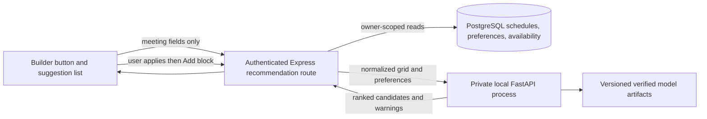

# SchedulaML Smart Schedule Operations

## Architecture



The browser never sends schedule context to the recommendation API; Express reads it for the authenticated schedule owner. The Smart Schedule button opens a dialog for meeting duration and type. Express requests up to five ranked candidates; the dialog shows each time, the model name/version, and relative scores when available. Choosing a candidate fills the weekday and time fields in the weekly block form. The user reviews the form and uses the existing **Add block** action to confirm; choosing a suggestion never saves it automatically. The Python service is bound to loopback and called only by Express.

## Contracts

### Browser to Express

`POST /api/schedules/:scheduleId/recommendations`

```json
{
  "meeting": {
    "duration_minutes": 60,
    "modality": "onsite",
    "type": "event"
  },
  "limit": 5
}
```

The request allows no schedule, preference, identity, title, or description data. Duration must be a whole hour from 60 to 900. Modality is `onsite` or `online`; type is `project`, `event`, or `meeting`; limit is 1–20.

### Express to Python

Express sends `context.occupancy`, `context.preferences`, `context.warnings`, `meeting`, and `limit` to `POST /rank`. The six-day grid has 15 hourly `ON`/`OL`/`OF` cells per day, Monday through Saturday. All blocks in the canonical weekly schedule count as classes. Dated events and active dated busy availability cannot be represented by the weekly model and stop the request with a safe `503`. Only onsite and online occupancy are supported; hybrid weekly blocks are rejected. See [schedulaml-feature-contract.md](schedulaml-feature-contract.md) for the source-field mapping.

### Python to Express/browser

```json
{
  "recommendations": [
    { "weekday": "Tuesday", "start_time": "10:00", "end_time": "11:00", "score": 0.82 }
  ],
  "model": { "name": "schedulaml-lgb", "version": "1.1.0" },
  "warnings": []
}
```

Scores are relative ranking values for the request's candidate set, not probabilities. A successful no-result response returns an empty array and warning. For a single-candidate L3 response, `score` is `null` and a warning explains that the layered score is unreliable. Model/validation failure returns a safe `503`; there is no silent rule fallback.

## Configuration

Copy the relevant keys from repository `.env.example` into the local backend `.env` after confirming the preference mappings:

| Variable | Purpose |
| --- | --- |
| `SMART_SCHEDULE_ENABLED` | Feature flag; defaults to `false`. Enable after applying migrations and configuring the local model service. |
| `SCHEDULAML_URL` | Local Python service base URL; default `http://127.0.0.1:8001`. |
| `SCHEDULAML_API_KEY` | Optional shared secret sent as `X-SchedulaML-Key`. Keep server-side only. |
| `SCHEDULAML_TIMEOUT_MS` | Express request timeout, bounded to 250–15000 ms. |

The setup/profile UI labels `commute_time` in minutes. The feature adapter converts those minutes to the SML `Commute` convention (hours when <=240 minutes, otherwise minutes). Back-to-back tolerance is stored as 0–6 and passed directly. Apply migrations `005_preferred_break` and `006_back_to_back_tolerance` before starting the updated API; preferred break defaults to 60 minutes, and tolerance is constrained to 0–6 in PostgreSQL.

## Local startup

1. Start PostgreSQL and apply the repository migrations.
2. In a PowerShell window, start SchedulaML:

   ```powershell
   cd C:\Users\Win11\Downloads\schedula\schedulaml
   .\.venv313\Scripts\Activate.ps1
   python -m uvicorn app.main:app --host 127.0.0.1 --port 8001 --env-file .env
   ```

3. The private shared key belongs in both ignored env files. Generate a high-entropy key in PowerShell with `$key = node -p "require('crypto').randomBytes(32).toString('base64url')"`, then set `SCHEDULAML_API_KEY=$key` in both `backend/.env` and `schedulaml/.env`. Keep the value server-side; Express sends it in `X-SchedulaML-Key`, and the browser never receives it. A key is optional only when the Python process remains private on loopback.
4. In `backend/.env`, set `SMART_SCHEDULE_ENABLED=true` and `SCHEDULAML_URL=http://127.0.0.1:8001`. Restart Express from `backend/` with `npm start` so it reloads the feature flag and key.
5. Open the builder, save the current schedule, and use **Smart Schedule** to request suggestions.

The local project env files are already configured with a generated shared key, the feature flag is enabled, and the Python service is running. Do not copy the key into frontend code, commit it, or paste it into a chat.

The supplied artifacts were serialized under Python 3.13.18, scikit-learn 1.6.1, LightGBM 4.6.0, NumPy 2.4.6, pandas 2.2.3, and joblib 1.6.0. Run under those pinned versions to avoid model-version warnings or incompatibility.

## PowerShell smoke requests

Health and version:

```powershell
Invoke-RestMethod http://127.0.0.1:8001/health
Invoke-RestMethod http://127.0.0.1:8001/version
```

Example direct Python rank request (the backend normally creates this normalized context):

```powershell
$days = 'mon','tue','wed','thu','fri','sat'
$bins = '0708','0810','1012','1214','1416','1618','1820','2022','2224'
$occupancy = @{}
foreach ($day in $days) { $occupancy[$day] = @('OF') * 15 }
$preferredDays = @{}; $avoidedDays = @{}
foreach ($day in $days) { $preferredDays[$day] = $false; $avoidedDays[$day] = $false }
$preferredTimes = @{}; $avoidedTimes = @{}
foreach ($bin in $bins) { $preferredTimes[$bin] = $false; $avoidedTimes[$bin] = $false }
$body = @{
  context = @{
    occupancy = $occupancy
    preferences = @{
      commute_minutes = 30; preferred_break_minutes = 30; back_to_back_tolerance = 0
      preferred_modality = 'No Preference'; preferred_days = $preferredDays; avoided_days = $avoidedDays
      preferred_time_bins = $preferredTimes; avoided_time_bins = $avoidedTimes
    }
    warnings = @()
  }
  meeting = @{ duration_minutes = 60; modality = 'onsite'; type = 'event' }
  limit = 5
} | ConvertTo-Json -Depth 8
Invoke-RestMethod http://127.0.0.1:8001/rank -Method Post -ContentType 'application/json' -Body $body
```

Do not use the example placeholder preference values as production defaults without the decisions listed in the feature contract.

## Tests and verification

From `schedulaml/` run `python -m pytest`; from `backend/` run `npm test`. Python regression fixtures compare the service's layered response against the original supplied predictor, and are not training-parity or accuracy tests. After any model update, also run the service version and health checks and verify that the manifest mismatch test fails closed.

The current development host used for this integration has Python 3.14.5 and lacks scikit-learn, LightGBM, and joblib. Tests requiring model deserialization must run on Python 3.13.18 with the pinned dependencies before rollout.

## Artifact swap and rollback

Never replace files in a running artifact directory. Copy the new, unchanged model bundle into `schedulaml/artifacts/<version>/`, add its SHA-256 `MANIFEST.json`, and test it using `SCHEDULAML_ARTIFACT_VERSION=<version>`. Keep previous artifact directories. Roll back by restarting the service with the previous `SCHEDULAML_ARTIFACT_VERSION`; no database migration is required.

## Rollout

The current feature-code density cutoffs are Light through 5 occupied hours, Medium above 5 through 15, and Heavy above 15; their training validity remains unverified. Keep request contexts out of logs. Expand rollout only after reviewers compare the selected scorer with the rule baseline using held-out evaluation; current metrics are pooled exploratory results without confidence intervals.
