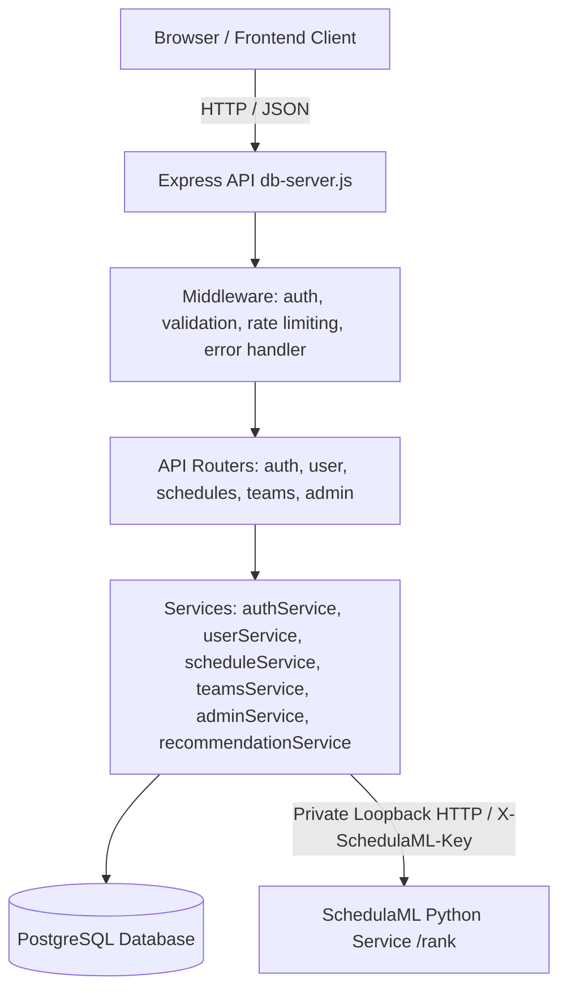

# Schedula Backend Schema

The backend is built with Node.js/Express and connects to PostgreSQL using parameterized SQL and UUID-based domain entities. Apply the executable migrations in `backend/sql/migrations/` (migrations 001 through 006) using the instructions in [DB_UPDATE_INSTRUCTIONS.md](../plans/DB_UPDATE_INSTRUCTIONS.md).

---

## Runtime Architecture & Services

The backend separates transport, security, and persistence into clear architectural layers:



### Module Breakdown

- `backend/db-server.js`: Express application bootstrap, middleware attachment (CORS, compression, rate limiter, JSON parser), route mounting (`/api`), and graceful database shutdown.
- `backend/config/`:
  - `database.js`: PostgreSQL connection pool management via `pg`, connection checks, and error logging.
  - `env.js`: Centralized environment variable loading and validation (`dotenv`), default fallbacks, and JWT/port configurations.
- `backend/middleware/`:
  - `auth.js`: JWT access token verification (`authenticateToken`) and role-based access control (`adminOnly`).
  - `validation.js`: Common input sanitization (email normalization and validation, non-empty string checks).
  - `errorHandler.js`: Centralized error-handling middleware converting exceptions to uniform JSON error responses.
- `backend/services/`:
  - `authService.js`: Registration, credential verification, JWT generation, refresh token rotation, and PIN-based password reset.
  - `userService.js`: User session, profile updates, account deletion cascades, preferences CRUD, and availability block CRUD.
  - `scheduleService.js`: Schedule container CRUD, weekly configuration validation, event CRUD, and GiST-indexed conflict detection.
  - `teamsService.js` / `teamsServiceCore.js`: Team membership, shared schedules, preferences, proposals, role changes, and team lifecycle operations.
  - `recommendationService.js`: SchedulaML integration orchestrator; loads schedule configuration and preferences, builds 6-day x 15-slot occupancy grids, enforces constraints, queries `schedulaml` inference service, and returns ranked slot suggestions.
  - `adminService.js`: Administrative user management and global schedule deletion.

---

## Runtime Database Tables

| Table | Primary Key | Foreign Keys & Cascades | Key Fields & Constraints | Purpose |
| :--- | :--- | :--- | :--- | :--- |
| `users` | `id UUID` | None | `email CITEXT UNIQUE`, `password_hash TEXT`, `platform_role TEXT CHECK ('user','admin')`, `deleted_at TIMESTAMPTZ` | Authentication identity & role |
| `profiles` | `id UUID` | `user_id UUID -> users(id) ON DELETE CASCADE` | `display_name TEXT`, `timezone TEXT DEFAULT 'UTC'`, `locale TEXT DEFAULT 'en-US'`, `avatar_url TEXT`, `working_hours JSONB` | Localization and user settings |
| `preferences` | `id UUID` | `user_id UUID -> users(id) ON DELETE CASCADE` | 9 pref time bins (`pref_time_0708`..`2224`), 6 pref days (`"PrefMon"`..`"PrefSat"`), 9 avoid time bins, 6 avoid days, `max_back_to_back INTEGER CHECK (0..6)`, `commute_time INTEGER CHECK (>=0)`, `preferred_break_minutes INTEGER CHECK (0..1440)`, `preferred_modality TEXT CHECK ('onsite','online','no preference')` | Smart Scheduling and ML preference features |
| `schedules` | `id UUID` | `owner_user_id UUID -> users(id) ON DELETE CASCADE`, `group_id UUID -> groups(id) ON DELETE SET NULL` | `title TEXT NOT NULL`, `timezone TEXT DEFAULT 'UTC'`, `color TEXT`, `deleted_at TIMESTAMPTZ` | Calendar schedule container |
| `schedule_context` | `id UUID` | `schedule_id UUID -> schedules(id) ON DELETE CASCADE` | `context JSONB NOT NULL DEFAULT '{}'` (stores array of weekly recurring blocks) | Schedule metadata & weekly configuration |
| `events` | `id UUID` | `schedule_id UUID -> schedules(id) ON DELETE CASCADE`, `owner_user_id UUID -> users(id) ON DELETE CASCADE` | `title TEXT NOT NULL`, `start_at TIMESTAMPTZ`, `end_at TIMESTAMPTZ CHECK (end_at > start_at)`, `timezone TEXT`, `event_window TSTZRANGE` (generated GiST), nullable details (`modality`, `location`, `priority`, etc.) | Scheduled event blocks |
| `availability_blocks` | `id UUID` | `user_id UUID -> users(id) ON DELETE CASCADE` | `start_at TIMESTAMPTZ`, `end_at TIMESTAMPTZ`, `availability_type TEXT CHECK ('free','busy')`, `availability_window TSTZRANGE` (generated GiST) | User availability and blocked time |
| `groups` | `id UUID` | `owner_user_id UUID -> users(id) ON DELETE CASCADE` | `name TEXT NOT NULL`, `description TEXT` | Collaboration team container |
| `memberships` | `id UUID` | `group_id UUID -> groups(id) ON DELETE CASCADE`, `user_id UUID -> users(id) ON DELETE CASCADE` | `role TEXT CHECK ('owner','admin','member','viewer')`, UNIQUE `(group_id, user_id)` | Team membership and permissions |
| `schedule_shares` | `id UUID` | `schedule_id UUID -> schedules(id) ON DELETE CASCADE`, `shared_with_user_id UUID`, `shared_with_group_id UUID` | `permission TEXT CHECK ('read','write','share')` | Schedule sharing permissions |
| `consolidated_views` | `id UUID` | `owner_user_id UUID -> users(id) ON DELETE CASCADE` | `name TEXT NOT NULL`, `configuration JSONB` | Multi-schedule merged calendar view |
| `invitations` | `id UUID` | `group_id UUID -> groups(id) ON DELETE CASCADE`, `invited_by_user_id UUID -> users(id) ON DELETE CASCADE` | `email CITEXT NOT NULL`, `role TEXT`, `token_hash TEXT UNIQUE`, `expires_at TIMESTAMPTZ`, `accepted_at TIMESTAMPTZ` | Group invitations |
| `refresh_tokens` | `id UUID` | `user_id UUID -> users(id) ON DELETE CASCADE` | `token_hash TEXT UNIQUE`, `expires_at TIMESTAMPTZ`, `revoked_at TIMESTAMPTZ` | Long-lived refresh token rotation |
| `password_reset_tokens` | `id UUID` | `user_id UUID -> users(id) ON DELETE CASCADE` | `token_hash TEXT UNIQUE`, `expires_at TIMESTAMPTZ`, `used_at TIMESTAMPTZ` | Expiring password reset PINs/tokens |

---

## API Endpoints Specification

### 1. Authentication Routes (`/api`)

| Method | Endpoint | Auth Required | Request Body | Response Status & Body |
| :--- | :--- | :---: | :--- | :--- |
| `POST` | `/api/signup` | No | `{ "email": "user@example.com", "password": "securePassword" }` | `201 Created`: `{ "user": { "id", "email", "access", "name" }, "accessToken", "refreshToken" }` |
| `POST` | `/api/login` | No | `{ "email": "user@example.com", "password": "securePassword" }` | `200 OK`: `{ "user": { "id", "email", "access", "name" }, "accessToken", "refreshToken" }` |
| `POST` | `/api/refresh` | No | `{ "refreshToken": "..." }` | `200 OK`: `{ "accessToken", "refreshToken" }` |
| `POST` | `/api/logout` | No | `{ "refreshToken": "..." }` | `200 OK`: `{ "message": "Successfully logged out" }` |
| `POST` | `/api/forgot-password` | No | `{ "email": "user@example.com" }` | `200 OK`: `{ "message": "If that email address exists in our database, we will send a password reset PIN." }` |
| `POST` | `/api/reset-password` | No | `{ "pin": "123456", "email": "user@example.com", "password": "newPassword" }` | `200 OK`: `{ "message": "Password has been reset successfully." }` |

### 2. User & Preferences Routes (`/api`)

All endpoints in this group require a valid Bearer JWT header: `Authorization: Bearer <accessToken>`.

| Method | Endpoint | Description | Request / Response Details |
| :--- | :--- | :--- | :--- |
| `GET` | `/api/user-session` | Retrieves user profile and session data | Returns `{ user_id, email, access, name, timezone, locale, avatar_url, working_hours }` |
| `PUT` | `/api/user/profile` | Updates user display profile or credentials | Body: `{ display_name?, timezone?, locale?, avatar_url?, working_hours?, email?, password? }` |
| `DELETE` | `/api/user/profile` | Deletes user account | Cascades deletion to schedules, events, preferences, groups, and tokens |
| `GET` | `/api/preferences` | Fetches normalized scheduling preferences | Returns preference booleans (`pref_time_*`, `Pref*`, `avoid_time_*`, `Avoid*`), `max_back_to_back`, `commute_time`, `preferred_break_minutes`, `preferred_modality` |
| `PUT` | `/api/preferences` | Updates scheduling preferences | Validates `max_back_to_back` (0–6), `commute_time` (>=0), `preferred_break_minutes` (0–1440), and `preferred_modality` (`'onsite' \| 'online' \| 'no preference'`) |
| `GET` | `/api/availability` | Lists user's availability blocks | Returns array of `{ id, user_id, start_at, end_at, timezone, availability_type, label }` |
| `POST` | `/api/availability` | Creates an availability block | Body: `{ start_at, end_at, timezone, availability_type: 'free'\|'busy', label? }` (Status `201`) |
| `DELETE` | `/api/availability/:id`| Deletes an availability block | Status `204 No Content` |

### 3. Schedules & Events Routes (`/api`)

All endpoints in this group require a valid Bearer JWT.

| Method | Endpoint | Description | Request / Response Details |
| :--- | :--- | :--- | :--- |
| `GET` | `/api/schedules` | Lists all active schedules for the user | Returns schedules with aggregated `configuration` (weekly blocks) and `events` |
| `POST` | `/api/schedules` | Creates a new schedule | Body: `{ title, timezone?, color?, configuration? }`. Status `201 Created` |
| `PUT` | `/api/schedules/:scheduleId` | Updates title, timezone, color, or configuration | Body: `{ title?, timezone?, color?, configuration? }` |
| `DELETE` | `/api/schedules/:scheduleId` | Soft deletes schedule | Sets `deleted_at = CURRENT_TIMESTAMP`. Status `204 No Content` |
| `GET` | `/api/schedules/:scheduleId/events` | Lists events of a specific schedule | Returns events array |
| `POST` | `/api/schedules/:scheduleId/events` | Creates an event on schedule | Body: `{ title, start_at, end_at, timezone?, description?, location?, modality?, category?, color?, priority?, status?, recurrence_rule?, reminder_offset_minutes?, notes? }`. Status `201 Created` |
| `PUT` | `/api/events/:eventId` | Updates an existing event | Body: Event fields to update |
| `DELETE` | `/api/events/:eventId` | Soft deletes event | Status `204 No Content` |
| `GET` | `/api/events/conflicts` | Queries time conflicts using GiST range overlap | Query parameters: `start_at`, `end_at`, optional `schedule_id`, optional `event_id`. Evaluates `event_window && tstzrange($start, $end, '[)')` |

### 4. Smart Scheduling Recommendation Route

- **Endpoint:** `POST /api/schedules/:scheduleId/recommendations`
- **Authentication:** Required (User must own the schedule)
- **Rate Limit:** Dedicated `recommendationLimiter` enforcing at most 30 requests per 15 minutes per IP.
- **Request Body Contract:**
  ```json
  {
    "meeting": {
      "duration_minutes": 60,
      "modality": "onsite",
      "type": "event"
    },
    "limit": 5
  }
  ```
  - `duration_minutes`: Whole number of hours between 60 and 900 (`duration_minutes % 60 === 0`).
  - `modality`: Exactly `"onsite"` or `"online"`.
  - `type`: Exactly `"project"`, `"event"`, or `"meeting"`.
  - `limit`: Integer from 1 to 20 (defaults to 5).
- **Processing Logic:**
  1. The schedule configuration (weekly blocks) is read from `schedule_context`.
  2. Any active dated busy availability blocks in `availability_blocks` stop the request with a safe `503 Service Unavailable` because the weekly model cannot represent arbitrary future dates.
  3. The weekly blocks are projected onto a 6-day (Mon–Sat) by 15-hourly-slot (07:00–22:00) grid with cells `'ON'` (onsite), `'OL'` (online), or `'OF'` (free/off).
  4. User preferences are verified (including `preferred_break_minutes` and `max_back_to_back`).
  5. The normalized payload is forwarded via loopback HTTP POST to `http://127.0.0.1:8001/rank` with header `X-SchedulaML-Key: <SCHEDULAML_API_KEY>`.
- **Response Format:**
  ```json
  {
    "recommendations": [
      {
        "weekday": "Tuesday",
        "start_time": "10:00",
        "end_time": "11:00",
        "score": 0.82
      }
    ],
    "model": {
      "name": "schedulaml-lgb",
      "version": "1.1.0"
    },
    "warnings": []
  }
  ```

### 5. Administrative Routes (`/api/admin`)

Requires authentication and platform role `platform_role === 'admin'`.

| Method | Endpoint | Description |
| :--- | :--- | :--- |
| `GET` | `/api/admin/users` | Lists all users with profile display names and platform roles |
| `POST` | `/api/admin/users` | Creates a new user with specified role and password |
| `PUT` | `/api/admin/users/:id` | Updates user email, role, or credentials |
| `DELETE` | `/api/admin/users/:id` | Soft deletes user account |
| `GET` | `/api/admin/schedules` | Lists all schedules across users with event counts |
| `DELETE` | `/api/admin/schedules/:id` | Soft deletes schedule by administrator |

### 6. Team Lifecycle Routes (`/api/teams`)

Team lifecycle routes require authentication. Only the current team creator (`groups.owner_user_id`) can delete a team. Deletion soft-deletes the group, memberships, invitations, and team share links; team events and proposals are removed. Schedules attached directly to the group are detached and remain with their owners. When a member leaves, creator ownership transfers to an active member if one remains; when the last member leaves, the same team cleanup runs for everyone.

| Method | Endpoint | Description |
| :--- | :--- | :--- |
| `POST` | `/api/teams/:teamId/leave` | Removes the current user's membership; leaving as the last member deletes the team for everyone |
| `DELETE` | `/api/teams/:teamId` | Deletes the team for everyone; current creator only |

---

## Configuration & Environment Variables

| Variable | Required | Default | Description |
| :--- | :---: | :--- | :--- |
| `PORT` | No | `3000` | Port for the Node.js Express API server |
| `DB_HOST` | No | `localhost` | PostgreSQL host |
| `DB_PORT` | No | `5432` | PostgreSQL port |
| `DB_NAME` | No | `schedula` | PostgreSQL database name |
| `DB_USER` | No | `postgres` | PostgreSQL username |
| `DB_PASSWORD` | Yes | - | PostgreSQL password |
| `JWT_SECRET` | Yes | - | Secret key used for signing JWT access tokens |
| `REFRESH_TOKEN_SECRET` | Yes | - | Secret key used for signing refresh tokens |
| `API_RATE_LIMIT` | No | `100` | Max requests per 15-minute window for `/api` |
| `SMART_SCHEDULE_ENABLED`| No | `false` | Enables the Smart Schedule recommendation endpoint |
| `SCHEDULAML_URL` | No | `http://127.0.0.1:8001` | SchedulaML FastAPI service base URL |
| `SCHEDULAML_API_KEY` | No | - | Shared secret sent in `X-SchedulaML-Key` |
| `SCHEDULAML_TIMEOUT_MS` | No | `3000` | HTTP timeout (bounded between 250ms and 15000ms) |
