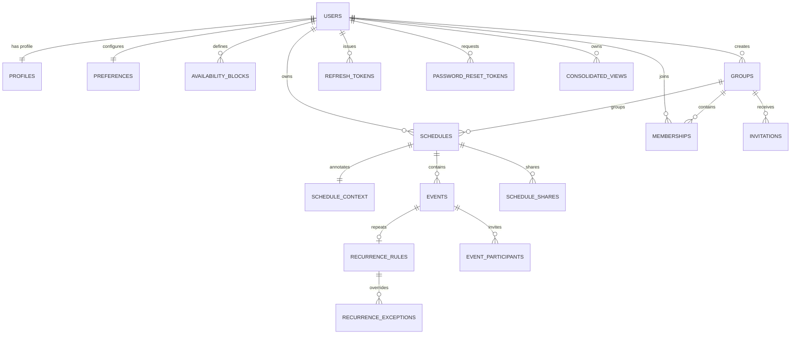

# Schedula Database Schema Architecture

This document is the architectural reference for Schedula's PostgreSQL database schema. Detailed constraint specifications are in [SCHEDULA_DB_PLAN.md](../plans/SCHEDULA_DB_PLAN.md); step-by-step migration execution instructions are in [DB_UPDATE_INSTRUCTIONS.md](../plans/DB_UPDATE_INSTRUCTIONS.md).

---

## Entity-Relationship Model



---

## Core Tables

### 1. Identity & Profile

#### `users`
Represents user authentication identity and platform-wide role.
- `id` (`UUID`, PK): Generated via `gen_random_uuid()`.
- `email` (`CITEXT`, NOT NULL, UNIQUE): Case-insensitive user email.
- `password_hash` (`TEXT`, NOT NULL): Blowfish password hash created via `crypt(password, gen_salt('bf'))`.
- `platform_role` (`TEXT`, NOT NULL, DEFAULT `'user'`): Restricted to `'user'` or `'admin'`.
- `created_at` (`TIMESTAMPTZ`, NOT NULL, DEFAULT `CURRENT_TIMESTAMP`)
- `updated_at` (`TIMESTAMPTZ`, NOT NULL, DEFAULT `CURRENT_TIMESTAMP`)
- `deleted_at` (`TIMESTAMPTZ`, NULL): Soft delete timestamp. Filtered out by `idx_users_active`.

#### `profiles`
Stores localized presentation details and working hour configurations.
- `id` (`UUID`, PK)
- `user_id` (`UUID`, NOT NULL, UNIQUE, FK `users(id)` ON DELETE CASCADE)
- `display_name` (`TEXT`, NULL): User's public display name.
- `timezone` (`TEXT`, NOT NULL, DEFAULT `'UTC'`): IANA timezone string (e.g. `'Asia/Manila'`).
- `locale` (`TEXT`, NOT NULL, DEFAULT `'en-US'`)
- `avatar_url` (`TEXT`, NULL)
- `working_hours` (`JSONB`, NOT NULL, DEFAULT `'{}'::jsonb`)
- Standard audit timestamps: `created_at`, `updated_at`, `deleted_at`.

#### `preferences`
Normalized scheduling preferences aligned with SchedulaML feature requirements (migrations 001, 003, 005, 006).
- `id` (`UUID`, PK)
- `user_id` (`UUID`, NOT NULL, UNIQUE, FK `users(id)` ON DELETE CASCADE)
- Preferred Time Bins (9 booleans):
  - `pref_time_0708`, `pref_time_0810`, `pref_time_1012`, `pref_time_1214`, `pref_time_1416`, `pref_time_1618`, `pref_time_1820`, `pref_time_2022`, `pref_time_2224` (NOT NULL, DEFAULT `FALSE`)
- Preferred Days (6 booleans):
  - `"PrefMon"`, `"PrefTue"`, `"PrefWed"`, `"PrefThurs"`, `"PrefFri"`, `"PrefSat"` (NOT NULL, DEFAULT `FALSE`)
- Avoided Time Bins (9 booleans):
  - `avoid_time_0708`, `avoid_time_0810`, `avoid_time_1012`, `avoid_time_1214`, `avoid_time_1416`, `avoid_time_1618`, `avoid_time_1820`, `avoid_time_2022`, `avoid_time_2224` (NOT NULL, DEFAULT `FALSE`)
- Avoided Days (6 booleans):
  - `"AvoidMon"`, `"AvoidTue"`, `"AvoidWed"`, `"AvoidThurs"`, `"AvoidFri"`, `"AvoidSat"` (NOT NULL, DEFAULT `FALSE`)
- Workload & Commute Controls:
  - `max_back_to_back` (`INTEGER`, NOT NULL, DEFAULT 0): Constrained between `0` and `6` (`CHECK (max_back_to_back BETWEEN 0 AND 6)`).
  - `commute_time` (`INTEGER`, NOT NULL, DEFAULT 0): Stored in minutes (`CHECK (commute_time >= 0)`).
  - `preferred_break_minutes` (`INTEGER`, NOT NULL, DEFAULT 60): Constrained between `0` and `1440` (`CHECK (preferred_break_minutes BETWEEN 0 AND 1440)`).
  - `preferred_modality` (`TEXT`, NOT NULL, DEFAULT `'no preference'`): Restricted to `'onsite'`, `'online'`, or `'no preference'`.

---

### 2. Schedules & Events

#### `schedules`
Top-level calendar container for personal and team schedules.
- `id` (`UUID`, PK)
- `owner_user_id` (`UUID`, NOT NULL, FK `users(id)` ON DELETE CASCADE)
- `group_id` (`UUID`, NULL, FK `groups(id)` ON DELETE SET NULL)
- `title` (`TEXT`, NOT NULL)
- `timezone` (`TEXT`, NOT NULL, DEFAULT `'UTC'`)
- `color` (`TEXT`, NULL): Hex color code for visualization.
- Standard audit timestamps: `created_at`, `updated_at`, `deleted_at`.

#### `schedule_context`
Flexible JSONB payload tied 1-to-1 to a schedule, storing weekly canonical recurring blocks used by the builder and SchedulaML.
- `id` (`UUID`, PK)
- `schedule_id` (`UUID`, NOT NULL, UNIQUE, FK `schedules(id)` ON DELETE CASCADE)
- `context` (`JSONB`, NOT NULL, DEFAULT `'{}'::jsonb`): Array of weekly blocks:
  ```json
  [
    {
      "title": "Software Engineering",
      "description": "Lecture & Lab",
      "weekdays": ["Monday"],
      "start_time": "08:00",
      "end_time": "10:00",
      "modality": "onsite"
    }
  ]
  ```
- Standard audit timestamps: `created_at`, `updated_at`, `deleted_at`.

#### `events`
Specific scheduled blocks with exact UTC timestamps and overlap detection.
- `id` (`UUID`, PK)
- `schedule_id` (`UUID`, NOT NULL, FK `schedules(id)` ON DELETE CASCADE)
- `owner_user_id` (`UUID`, NOT NULL, FK `users(id)` ON DELETE CASCADE)
- `title` (`TEXT`, NOT NULL)
- `start_at` (`TIMESTAMPTZ`, NOT NULL)
- `end_at` (`TIMESTAMPTZ`, NOT NULL, `CHECK (end_at > start_at)`)
- `timezone` (`TEXT`, NOT NULL, DEFAULT `'UTC'`)
- `event_window` (`TSTZRANGE`, GENERATED ALWAYS AS `(tstzrange(start_at, end_at, '[)')) STORED`)
- Nullable details:
  - `description`, `location`, `modality` (`CHECK (modality IS NULL OR modality IN ('in_person', 'online', 'hybrid'))`), `category`, `color`, `priority` (`INTEGER`), `status`, `recurrence_rule`, `reminder_offset_minutes` (`CHECK (>= 0)`), `notes`.
- Standard audit timestamps: `created_at`, `updated_at`, `deleted_at`.
- **Index:** GiST index on `event_window` for sub-millisecond overlap queries (`event_window && tstzrange($start, $end, '[)')`).

#### `availability_blocks`
User-level availability windows for free/busy detection.
- `id` (`UUID`, PK)
- `user_id` (`UUID`, NOT NULL, FK `users(id)` ON DELETE CASCADE)
- `start_at` (`TIMESTAMPTZ`, NOT NULL)
- `end_at` (`TIMESTAMPTZ`, NOT NULL, `CHECK (end_at > start_at)`)
- `timezone` (`TEXT`, NOT NULL, DEFAULT `'UTC'`)
- `availability_type` (`TEXT`, NOT NULL, `CHECK (availability_type IN ('free', 'busy'))`)
- `label` (`TEXT`, NULL)
- `availability_window` (`TSTZRANGE`, GENERATED ALWAYS AS `(tstzrange(start_at, end_at, '[)')) STORED`)
- Standard audit timestamps: `created_at`, `updated_at`, `deleted_at`.
- **Index:** GiST index on `availability_window`.

---

### 3. Recurrence & Collaboration Tables

| Table | Purpose | Keys & Constraints |
| :--- | :--- | :--- |
| `recurrence_rules` | RFC 5545 RRULE expressions for recurring events | `event_id UUID UNIQUE FK events(id) ON DELETE CASCADE`, `rrule TEXT`, `timezone TEXT`, `dtstart TIMESTAMPTZ`, `until_at TIMESTAMPTZ` |
| `recurrence_exceptions` | Specific occurrence cancellations or modifications | `recurrence_rule_id UUID FK recurrence_rules(id) ON DELETE CASCADE`, `occurrence_at TIMESTAMPTZ`, `is_cancelled BOOLEAN`, `override_values JSONB`, UNIQUE `(recurrence_rule_id, occurrence_at)` |
| `event_participants` | Event attendance and response states | `event_id UUID FK events(id) ON DELETE CASCADE`, `user_id UUID FK users(id) ON DELETE CASCADE`, `role TEXT`, `response_status TEXT`, UNIQUE `(event_id, user_id)` |
| `groups` | Team containers for shared schedules | `owner_user_id UUID FK users(id) ON DELETE CASCADE`, `name TEXT NOT NULL`, `description TEXT` |
| `memberships` | User-to-group role bindings | `group_id UUID FK groups(id) ON DELETE CASCADE`, `user_id UUID FK users(id) ON DELETE CASCADE`, `role TEXT CHECK ('owner','admin','member','viewer')`, UNIQUE `(group_id, user_id)` |
| `schedule_shares` | Explicit schedule sharing permissions | `schedule_id UUID FK schedules(id) ON DELETE CASCADE`, `shared_with_user_id UUID`, `shared_with_group_id UUID`, `permission TEXT CHECK ('read','write','share')`, CHECK `((shared_with_user_id IS NULL) <> (shared_with_group_id IS NULL))` |
| `consolidated_views` | Merged calendar view configurations across members | `owner_user_id UUID FK users(id) ON DELETE CASCADE`, `name TEXT`, `configuration JSONB` |
| `invitations` | Group invitations with cryptographically hashed tokens | `group_id UUID FK groups(id) ON DELETE CASCADE`, `invited_by_user_id UUID FK users(id) ON DELETE CASCADE`, `email CITEXT`, `token_hash TEXT UNIQUE`, `expires_at TIMESTAMPTZ` |
| `refresh_tokens` | Authentication token rotation persistence | `user_id UUID FK users(id) ON DELETE CASCADE`, `token_hash TEXT UNIQUE`, `expires_at TIMESTAMPTZ`, `revoked_at TIMESTAMPTZ` |
| `password_reset_tokens`| Password recovery tokens/PINs | `user_id UUID FK users(id) ON DELETE CASCADE`, `token_hash TEXT UNIQUE`, `expires_at TIMESTAMPTZ`, `used_at TIMESTAMPTZ` |

---

## Migration Sequence

The database schema is evolved via ordered SQL migration scripts located in `backend/sql/migrations/`:

```
001_schedula_schema.up.sql
└── 002_demo_seed.up.sql
    └── 003_preferences_rebuild.up.sql
        └── 004_account_deletion_cascade.up.sql
            └── 005_preferred_break.up.sql
                └── 006_back_to_back_tolerance.up.sql
```

1. **`001_schedula_schema.up.sql`**: Initializes PostgreSQL extensions (`pgcrypto`, `citext`, `btree_gist`), sets up the `set_updated_at()` trigger function, creates all base tables, defines GiST indexes on range columns, and attaches `BEFORE UPDATE` timestamp triggers.
2. **`002_demo_seed.up.sql`**: Inserts idempotent generic seed records (demo accounts, demo team, preferences, availability blocks, and sample schedules).
3. **`003_preferences_rebuild.up.sql`**: Normalizes `preferences` into individual time-bin (`pref_time_0708`..`2224`, `avoid_time_0708`..`2224`) and day (`PrefMon`..`PrefSat`, `AvoidMon`..`AvoidSat`) booleans, setting up structured feature inputs for SchedulaML.
4. **`004_account_deletion_cascade.up.sql`**: Adds `ON DELETE CASCADE` to foreign keys referencing `users(id)` in `groups`, `schedules`, `events`, and `invitations`, ensuring clean account deletion.
5. **`005_preferred_break.up.sql`**: Adds `preferred_break_minutes` (default 60, range 0–1440) to `preferences`.
6. **`006_back_to_back_tolerance.up.sql`**: Replaces the unbounded `max_back_to_back >= 0` check with `CHECK (max_back_to_back BETWEEN 0 AND 6)` to match the SchedulaML 0–6 scale.

### Rollback Strategy
Each migration is accompanied by a matching `.down.sql` script that performs targeted teardown in reverse numerical order (`006` -> `001`).
